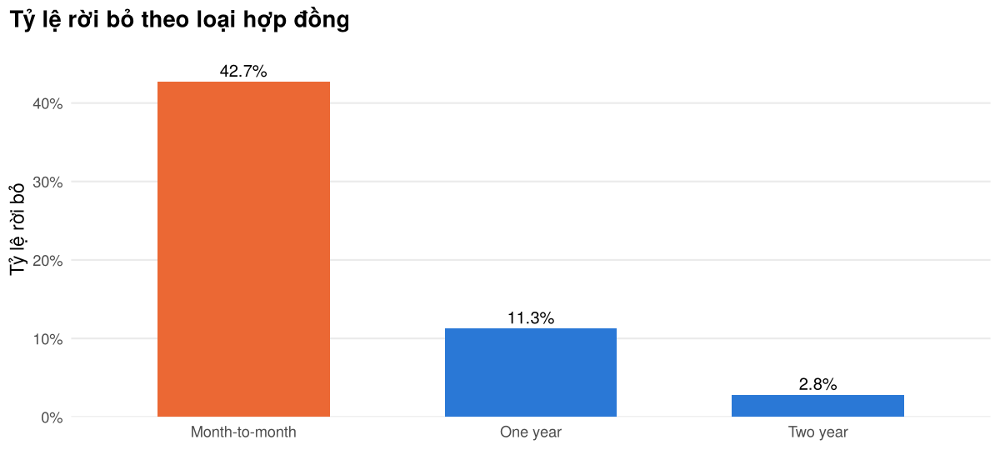
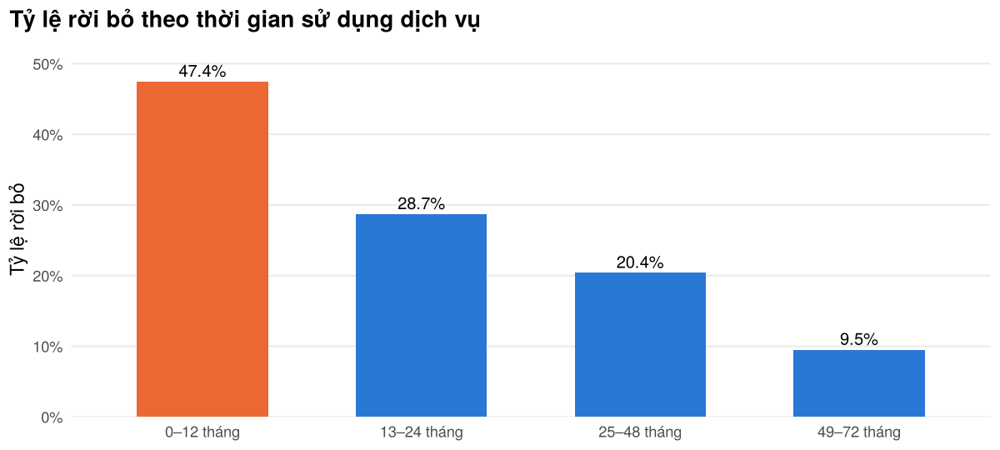
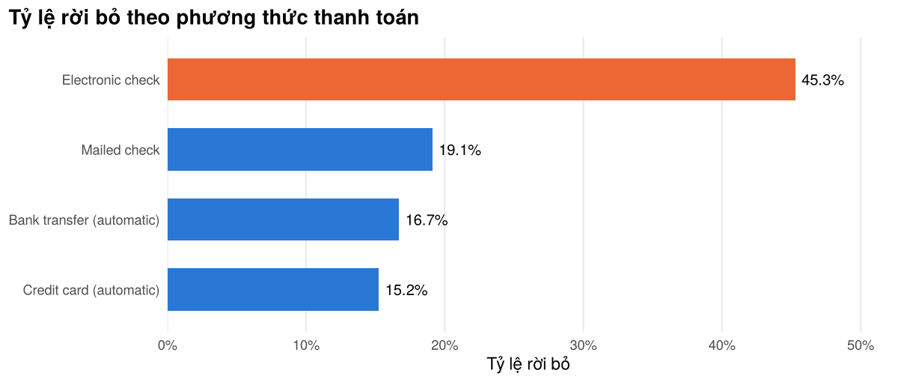
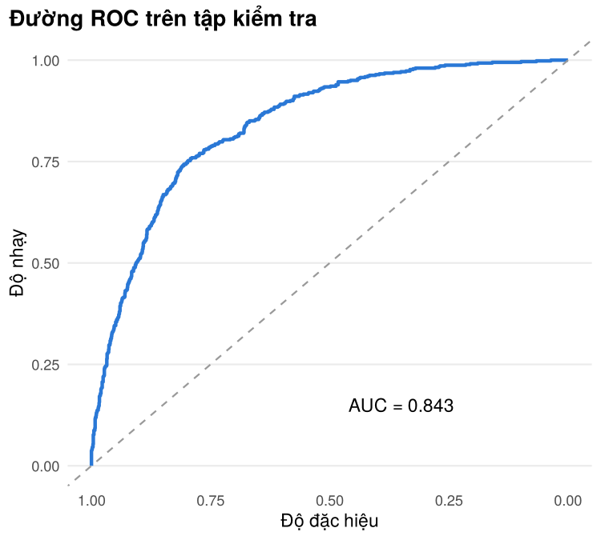
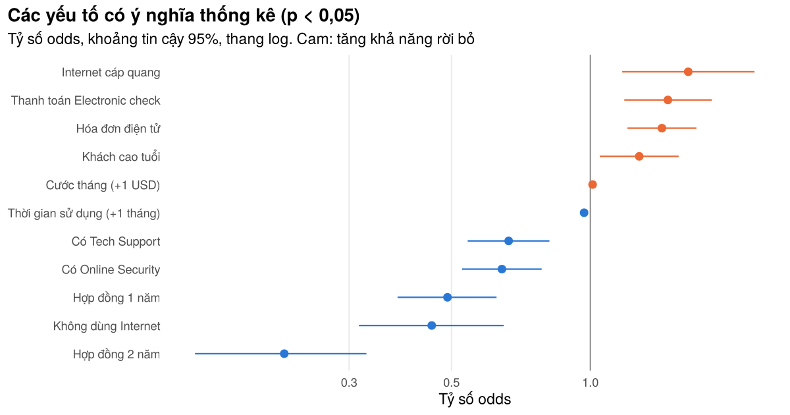

Phân tích tỷ lệ rời bỏ của khách hàng viễn thông
================
Nguyễn Duy Hiếu

- [1. Dữ liệu và làm sạch](#1-dữ-liệu-và-làm-sạch)
- [2. Tỷ lệ rời bỏ theo nhóm khách
  hàng](#2-tỷ-lệ-rời-bỏ-theo-nhóm-khách-hàng)
- [3. Mô hình hồi quy logistic](#3-mô-hình-hồi-quy-logistic)
- [4. Nhận định](#4-nhận-định)

## 1. Dữ liệu và làm sạch

Bộ dữ liệu IBM Telco Customer Churn: mỗi dòng là một khách hàng, cột
`Churn` cho biết khách đã rời bỏ trong tháng gần nhất hay chưa.

``` r
raw <- read_csv("../data/Telco-Customer-Churn.csv", show_col_types = FALSE)
dim(raw)
```

    ## [1] 7043   21

``` r
# Giá trị thiếu: TotalCharges trống ở các khách mới (tenure = 0, chưa có hóa đơn)
raw %>% summarise(across(everything(), ~ sum(is.na(.)))) %>%
  pivot_longer(everything(), names_to = "cot", values_to = "so_thieu") %>% filter(so_thieu > 0)
```

    ## # A tibble: 1 × 2
    ##   cot          so_thieu
    ##   <chr>           <int>
    ## 1 TotalCharges       11

``` r
raw %>% filter(is.na(TotalCharges)) %>% count(tenure)
```

    ## # A tibble: 1 × 2
    ##   tenure     n
    ##    <dbl> <int>
    ## 1      0    11

``` r
df <- raw %>%
  mutate(
    TotalCharges = replace_na(TotalCharges, 0),               # khách mới: tổng phí = 0
    churn        = as.integer(Churn == "Yes"),
    SeniorCitizen = factor(if_else(SeniorCitizen == 1, "Yes", "No")),
    # "No internet service" trùng thông tin với InternetService = "No" -> gộp về "No"
    across(c(OnlineSecurity, OnlineBackup, DeviceProtection, TechSupport, StreamingTV, StreamingMovies),
           ~ factor(if_else(. == "No internet service", "No", .))),
    MultipleLines = factor(if_else(MultipleLines == "No phone service", "No", MultipleLines)),
    Contract      = factor(Contract, levels = c("Month-to-month", "One year", "Two year")),
    InternetService = factor(InternetService, levels = c("DSL", "Fiber optic", "No")),
    PaymentMethod = factor(PaymentMethod),
    tenure_group  = cut(tenure, breaks = c(-1, 12, 24, 48, 72),
                        labels = c("0–12 tháng", "13–24 tháng", "25–48 tháng", "49–72 tháng"))
  )

cat("Số khách hàng:", nrow(df), "| Tỷ lệ rời bỏ:", percent(mean(df$churn), 0.1), "\n")
```

    ## Số khách hàng: 7043 | Tỷ lệ rời bỏ: 26.5%

## 2. Tỷ lệ rời bỏ theo nhóm khách hàng

``` r
rate_by <- function(data, var) {
  data %>% group_by(nhom = {{ var }}) %>%
    summarise(so_khach = n(), so_roi_bo = sum(churn), ty_le_roi_bo = mean(churn), .groups = "drop")
}
by_contract <- rate_by(df, Contract)
by_tenure   <- rate_by(df, tenure_group)
by_payment  <- rate_by(df, PaymentMethod) %>% arrange(desc(ty_le_roi_bo))
by_internet <- rate_by(df, InternetService)

bind_rows(list(`Loại hợp đồng` = by_contract, `Thời gian sử dụng` = by_tenure,
               `Phương thức thanh toán` = by_payment, `Dịch vụ Internet` = by_internet), .id = "bien") %>%
  mutate(nhom = as.character(nhom)) %>%
  write_csv("../outputs/churn_rate_by_group.csv")

knitr::kable(by_contract %>% mutate(ty_le_roi_bo = percent(ty_le_roi_bo, 0.1)), caption = "Theo loại hợp đồng")
```

| nhom           | so_khach | so_roi_bo | ty_le_roi_bo |
|:---------------|---------:|----------:|:-------------|
| Month-to-month |     3875 |      1655 | 42.7%        |
| One year       |     1473 |       166 | 11.3%        |
| Two year       |     1695 |        48 | 2.8%         |

Theo loại hợp đồng

``` r
knitr::kable(by_tenure   %>% mutate(ty_le_roi_bo = percent(ty_le_roi_bo, 0.1)), caption = "Theo thời gian sử dụng")
```

| nhom        | so_khach | so_roi_bo | ty_le_roi_bo |
|:------------|---------:|----------:|:-------------|
| 0–12 tháng  |     2186 |      1037 | 47.4%        |
| 13–24 tháng |     1024 |       294 | 28.7%        |
| 25–48 tháng |     1594 |       325 | 20.4%        |
| 49–72 tháng |     2239 |       213 | 9.5%         |

Theo thời gian sử dụng

``` r
knitr::kable(by_payment  %>% mutate(ty_le_roi_bo = percent(ty_le_roi_bo, 0.1)), caption = "Theo phương thức thanh toán")
```

| nhom                      | so_khach | so_roi_bo | ty_le_roi_bo |
|:--------------------------|---------:|----------:|:-------------|
| Electronic check          |     2365 |      1071 | 45.3%        |
| Mailed check              |     1612 |       308 | 19.1%        |
| Bank transfer (automatic) |     1544 |       258 | 16.7%        |
| Credit card (automatic)   |     1522 |       232 | 15.2%        |

Theo phương thức thanh toán

``` r
plot_rate <- function(tb, title, highlight) {
  ggplot(tb, aes(x = nhom, y = ty_le_roi_bo, fill = nhom == highlight)) +
    geom_col(width = 0.6) +
    geom_text(aes(label = percent(ty_le_roi_bo, 0.1)), vjust = -0.4, size = 3.4) +
    scale_fill_manual(values = c(`TRUE` = ORANGE, `FALSE` = BLUE), guide = "none") +
    scale_y_continuous(labels = percent, expand = expansion(mult = c(0, 0.12))) +
    labs(title = title, x = NULL, y = "Tỷ lệ rời bỏ")
}
plot_rate(by_contract, "Tỷ lệ rời bỏ theo loại hợp đồng", "Month-to-month")
```

<!-- -->

``` r
plot_rate(by_tenure, "Tỷ lệ rời bỏ theo thời gian sử dụng dịch vụ", "0–12 tháng")
```

<!-- -->

``` r
ggplot(by_payment, aes(x = reorder(nhom, ty_le_roi_bo), y = ty_le_roi_bo,
                       fill = nhom == "Electronic check")) +
  geom_col(width = 0.6) +
  geom_text(aes(label = percent(ty_le_roi_bo, 0.1)), hjust = -0.15, size = 3.4) +
  scale_fill_manual(values = c(`TRUE` = ORANGE, `FALSE` = BLUE), guide = "none") +
  scale_y_continuous(labels = percent, expand = expansion(mult = c(0, 0.15))) +
  coord_flip() +
  labs(title = "Tỷ lệ rời bỏ theo phương thức thanh toán", x = NULL, y = "Tỷ lệ rời bỏ") +
  theme(panel.grid.major.y = element_blank(), panel.grid.major.x = element_line())
```

<!-- -->

Kiểm định chi bình phương cho mối liên hệ giữa loại hợp đồng và rời bỏ:

``` r
chisq.test(table(df$Contract, df$churn))
```

    ## 
    ##  Pearson's Chi-squared test
    ## 
    ## data:  table(df$Contract, df$churn)
    ## X-squared = 1184.6, df = 2, p-value < 2.2e-16

## 3. Mô hình hồi quy logistic

Chia dữ liệu 70/30 theo phân tầng biến `churn` (giữ nguyên tỷ lệ rời bỏ
ở hai tập). `TotalCharges` không đưa vào mô hình vì gần như bằng
`tenure × MonthlyCharges` (đa cộng tuyến).

``` r
set.seed(42)
idx   <- df %>% mutate(id = row_number()) %>% group_by(churn) %>% slice_sample(prop = 0.7) %>% pull(id)
train <- df[idx, ]
test  <- df[-idx, ]
c(train = nrow(train), test = nrow(test),
  churn_train = round(mean(train$churn), 3), churn_test = round(mean(test$churn), 3))
```

    ##       train        test churn_train  churn_test 
    ##    4929.000    2114.000       0.265       0.265

``` r
fml <- churn ~ tenure + MonthlyCharges + Contract + InternetService + PaymentMethod +
               PaperlessBilling + SeniorCitizen + OnlineSecurity + TechSupport
model <- glm(fml, data = train, family = binomial)

odds <- tidy(model, exponentiate = TRUE, conf.int = TRUE) %>%
  filter(term != "(Intercept)") %>%
  mutate(across(c(estimate, conf.low, conf.high), ~ round(., 3)), p.value = signif(p.value, 3)) %>%
  arrange(p.value)
write_csv(odds, "../outputs/odds_ratios.csv")
knitr::kable(odds %>% select(term, odds_ratio = estimate, conf.low, conf.high, p.value),
             caption = "Tỷ số odds (OR > 1: tăng khả năng rời bỏ; OR < 1: giảm)")
```

| term                                 | odds_ratio | conf.low | conf.high |  p.value |
|:-------------------------------------|-----------:|---------:|----------:|---------:|
| tenure                               |      0.969 |    0.964 |     0.974 | 0.00e+00 |
| ContractTwo year                     |      0.217 |    0.139 |     0.327 | 0.00e+00 |
| ContractOne year                     |      0.490 |    0.382 |     0.626 | 0.00e+00 |
| OnlineSecurityYes                    |      0.643 |    0.527 |     0.784 | 1.34e-05 |
| InternetServiceNo                    |      0.453 |    0.315 |     0.649 | 1.69e-05 |
| PaperlessBillingYes                  |      1.429 |    1.203 |     1.697 | 4.77e-05 |
| TechSupportYes                       |      0.665 |    0.542 |     0.815 | 8.76e-05 |
| PaymentMethodElectronic check        |      1.472 |    1.184 |     1.834 | 5.18e-04 |
| InternetServiceFiber optic           |      1.629 |    1.172 |     2.268 | 3.73e-03 |
| MonthlyCharges                       |      1.011 |    1.003 |     1.019 | 7.10e-03 |
| SeniorCitizenYes                     |      1.276 |    1.048 |     1.553 | 1.52e-02 |
| PaymentMethodCredit card (automatic) |      0.939 |    0.721 |     1.222 | 6.39e-01 |
| PaymentMethodMailed check            |      0.971 |    0.747 |     1.263 | 8.25e-01 |

Tỷ số odds (OR \> 1: tăng khả năng rời bỏ; OR \< 1: giảm)

``` r
test$prob <- predict(model, newdata = test, type = "response")
roc_obj   <- roc(test$churn, test$prob, quiet = TRUE)
test$pred <- as.integer(test$prob >= 0.5)

cm <- table(Thuc_te = test$churn, Du_doan = test$pred)
cm
```

    ##        Du_doan
    ## Thuc_te    0    1
    ##       0 1385  168
    ##       1  260  301

``` r
metrics <- tibble(
  auc       = as.numeric(auc(roc_obj)),
  accuracy  = mean(test$pred == test$churn),
  precision = cm["1", "1"] / sum(cm[, "1"]),
  recall    = cm["1", "1"] / sum(cm["1", ]),
  baseline_accuracy = 1 - mean(test$churn)          # đoán tất cả "không rời bỏ"
) %>% mutate(across(everything(), ~ round(., 3)))
write_csv(metrics, "../outputs/model_metrics.csv")
knitr::kable(metrics, caption = "Đánh giá trên tập kiểm tra (ngưỡng 0,5)")
```

|   auc | accuracy | precision | recall | baseline_accuracy |
|------:|---------:|----------:|-------:|------------------:|
| 0.843 |    0.798 |     0.642 |  0.537 |             0.735 |

Đánh giá trên tập kiểm tra (ngưỡng 0,5)

``` r
ggroc(roc_obj, colour = BLUE, linewidth = 1) +
  geom_abline(slope = 1, intercept = 1, linetype = "dashed", colour = "grey60") +
  annotate("text", x = 0.35, y = 0.15, label = paste0("AUC = ", round(auc(roc_obj), 3))) +
  labs(title = "Đường ROC trên tập kiểm tra", x = "Độ đặc hiệu", y = "Độ nhạy")
```

<!-- -->

``` r
# Nhãn dễ đọc cho từng biến
labels_vi <- c(
  "tenure" = "Thời gian sử dụng (+1 tháng)", "MonthlyCharges" = "Cước tháng (+1 USD)",
  "ContractOne year" = "Hợp đồng 1 năm", "ContractTwo year" = "Hợp đồng 2 năm",
  "InternetServiceFiber optic" = "Internet cáp quang", "InternetServiceNo" = "Không dùng Internet",
  "PaymentMethodElectronic check" = "Thanh toán Electronic check", "PaperlessBillingYes" = "Hóa đơn điện tử",
  "SeniorCitizenYes" = "Khách cao tuổi", "OnlineSecurityYes" = "Có Online Security", "TechSupportYes" = "Có Tech Support")
odds %>%
  filter(p.value < 0.05) %>%
  mutate(term = labels_vi[term]) %>%
  ggplot(aes(x = reorder(term, estimate), y = estimate, colour = estimate > 1)) +
  geom_hline(yintercept = 1, colour = "grey60") +
  geom_pointrange(aes(ymin = conf.low, ymax = conf.high), size = 0.4) +
  scale_colour_manual(values = c(`TRUE` = ORANGE, `FALSE` = BLUE), guide = "none") +
  scale_y_log10() + coord_flip() +
  labs(title = "Các yếu tố có ý nghĩa thống kê (p < 0,05)",
       subtitle = "Tỷ số odds, khoảng tin cậy 95%, thang log. Cam: tăng khả năng rời bỏ",
       x = NULL, y = "Tỷ số odds") +
  theme(panel.grid.major.y = element_blank(), panel.grid.major.x = element_line())
```

<!-- -->

## 4. Nhận định

- Tỷ lệ rời bỏ chung là **26.5%**.
- **Loại hợp đồng là yếu tố tách biệt rõ nhất:** khách hợp đồng theo
  tháng rời bỏ **42.7%**, so với 11.3% (1 năm) và 2.8% (2 năm). Sau khi
  kiểm soát các biến khác, hợp đồng 2 năm có odds rời bỏ bằng **0.217**
  lần hợp đồng theo tháng.
- **Khách mới dễ rời bỏ nhất:** nhóm sử dụng 0–12 tháng có tỷ lệ rời bỏ
  **47.4%**, so với 9.5% ở nhóm trên 4 năm.
- **Thanh toán bằng Electronic check** có tỷ lệ rời bỏ **45.3%**, cao
  nhất trong các phương thức thanh toán.
- **Internet cáp quang (Fiber optic)** làm tăng odds rời bỏ (OR = 1.629
  so với DSL), trong khi có **Online Security** (OR = 0.643) hoặc **Tech
  Support** (OR = 0.665) làm giảm.
- Mô hình đạt **AUC = 0.843** trên tập kiểm tra; ở ngưỡng 0,5, độ chính
  xác 79.8% (so với 73.5% nếu đoán tất cả “không rời bỏ”) và phát hiện
  được 53.7% khách thực sự rời bỏ.

**Đề xuất:** ưu đãi chuyển khách hợp đồng theo tháng sang hợp đồng 1–2
năm trong 12 tháng đầu; khuyến khích chuyển sang thanh toán tự động;
tặng thử Online Security/Tech Support cho khách dùng cáp quang.
